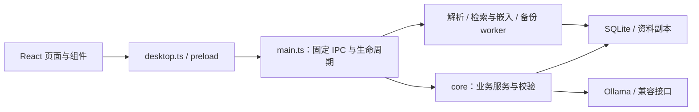

# 整体架构与维护评估

<!-- Updated: 2026-10-21 | Source files scanned: 167 -->

当前是一个 Electron 桌面应用。React 负责展示，主进程拥有本机权限，三个 utility worker 承担解析、检索／推理和备份。目录整理保留这一结构。

## 当前合理的边界

- renderer 不直接访问文件、SQLite、密钥或模型；preload 暴露固定方法。
- 业务服务负责证据、版本、确认与持久化；模型输出不能获得工具权限。
- 主库、活动库、派生索引和密钥分开；恢复不会把旧索引当原始数据。
- CPU 工作移到 worker；取消与进程退出由主进程收口。
- 本地模型与云接口共用生成管线，空证据可直接本地返回。

## 本轮判断

**继续保留单仓库、单桌面应用。** 当前没有把它拆成微服务、独立后端或多包工程的实际需要。维护难点主要是入口职责与源码摆放，而不是技术栈选错。

| 优先级 | 压力点                                      | 后续适合的小步调整                                         |
| ------ | ------------------------------------------- | ---------------------------------------------------------- |
| 先处理 | `App.tsx` 约 686 行，集中跨页导航与草稿连接 | 按需要提取导航／阅读工作区状态，保持页面挂载和迟到结果保护 |
| 先处理 | `main.ts` 约 854 行，集中 IPC 与启动装配    | 以后按业务拆注册函数，保留固定频道和来源校验               |
| 后续   | 后端依赖 `src/lib` 中的类型和纯规则         | 单独评估 `shared/` 契约目录；界面 hook 不应跟随迁入        |
| 后续   | `styles.css` 约 2544 行，仍混有功能样式     | 在修改对应功能时迁移样式，避免一次改动全部主题与布局       |

本轮实际完成组件分组、测试归位、文档分流和开发文件监听边界设置，未做上述行为性拆分，也没有改变 IPC、数据库版本或打包路径。目录名表示阅读归属，不代表已经强制执行领域隔离。

阅读顺序：[前端](frontend.md) → [主进程](backend.md) → [数据](data.md) → [构建依赖](dependencies.md)。
