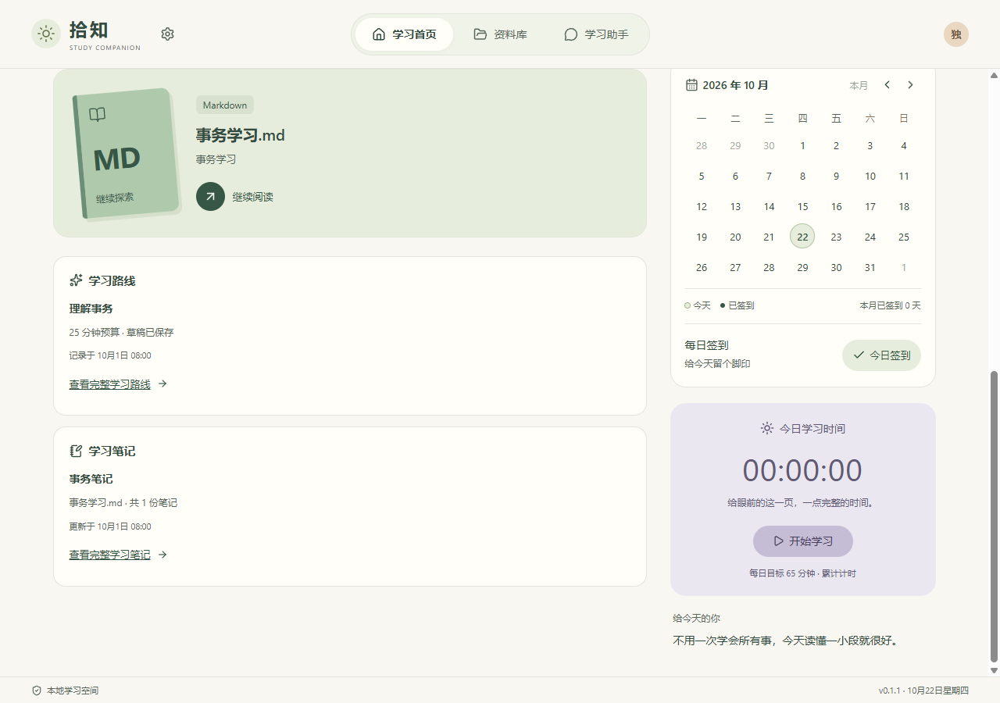

# 晴岛：正式桌面 UI 设计与维护规范

选定并落地日期：2026-10-18。设计 ID：`shizhi.sunny-isle.v1`。用户明确选择第一轮 **03 晴岛原版**作为正式 UI 基线，已接入桌面程序。第二轮玄墨、赤陶、蓝调仅保留为比较档案。

本规范描述正式 React 界面的视觉和维护边界。原始 [晴岛 demo](../../design-lab/2026-10-17-three-directions/03-island/index.html) 和 [概念 JSON](../../design-lab/2026-10-17-three-directions/03-island/design.json) 继续作为历史快照；正式状态从 [选定档案](../../design-lab/selected-design.json) 进入，实际验证见 [本次交接](../handoffs/2026-10-18-sunny-isle.md)。

2026-10-21 同一晴岛基线增加全功能动效，详见[动效设计与维护规范](SUNNY_MOTION.md)及[实施交接](../handoffs/2026-10-21-sunny-motion.md)。本文件继续负责静态外观，动效扩展不改变配色或产品能力。

2026-10-22 导航与首页信息层级按[新规范](SUNNY_NAVIGATION.md)整理：设置在左上品牌旁，主导航仅三项，右上仅头像；首页资料下方展示路线／笔记摘要，其他四类学习工具收进设置。历史 demo 保留原始快照。

2026-10-22 已与完整学习主线整合，当前保留九项真实导航、笔记／任务／复习／阅读侧栏与三主题；下表中的规划入口及旧截图仅描述2026-10-18对象，不代表当前能力范围。当前实现与验证见[整合交接](../testing/updates-integration-2026-10-22.md)。

## 正式窗口快照

以下来自隔离目录、合成学习记录的真实 Electron 窗口，显示本轮导航和首页摘要；截图不代表软件预置资料或进度。后续视觉变更需同步更新这些快照与选定档案。

[查看当前设置学习工具](../../design-lab/2026-10-22-sunny-navigation/previews/06-desktop-settings.png)。原[首页](assets/sunny-isle-home.png)与[900×640学习助手](assets/sunny-isle-chat-900.png)保留为2026-10-18历史快照。

## 设计目标与选择依据

保留晴岛原版的顶部胶囊导航、温暖浅底、薄荷欢迎区、叠书植物和下方不对称双列。它要像一个能长期打开的私人学习空间：资料和下一步操作清楚，签到与时长有自己的位置，阅读与问答保持安静。

陪伴感来自文案、配色和留白。插画不表示知识掌握、学习等级或植物成长。没有记录时展示真实空态，不复制 demo 的书名、进度、日期或回答。

## 页面与真实数据

| 区域     | 正式布局                                                                 | 数据与操作                                                                          |
| -------- | ------------------------------------------------------------------------ | ----------------------------------------------------------------------------------- |
| 全局框架 | 左侧拾知品牌与设置齿轮、中间三个胶囊导航、右侧独立昵称头像；页面内容居中 | 保留现有启动加载、失败与重试；头像不引入账号                                        |
| 欢迎横幅 | 薄荷底、大标题、左侧资料库入口；右侧本地叠书植物 SVG 与杏色贴纸          | 称呼来自已保存设置；插画仅装饰，不依赖网络、不跟随学习数值变化                      |
| 首页左列 | 最近资料的大卡与后续资料列表；下方路线和笔记摘要及详情链接               | 数据来自实际保存记录；无资料、无记录和读取失败分别保留提示                          |
| 首页右列 | 白色完整月历与签到，下方灰紫累计计时                                     | 完整月份、切月、返回本月、今日/签到标记与月度统计保留；签到与手动计时互相独立       |
| 资料库   | 沿用导入、搜索、格式筛选与资料列表；应用统一浅底、卡片、按钮与输入框     | 保留重复/逐文件错误、进度与取消，不把原生导入改成 demo 弹窗                         |
| 阅读器   | 阅读工具、目录、正文与原页区套用晴岛表面和边框                           | PDF 仍由 PDF.js 渲染原页；Markdown 保留安全内容规则、护眼、目录、阅读位置和引用复制 |
| 学习助手 | 现有会话列表、问题、预览、流式回答和证据卡片统一视觉                     | 普通聊天／资料问答、停止、错误和远程确认照常工作；切页隐藏而不卸载聊天组件          |
| 设置     | 学习工具区收纳专注、计划、复习、记忆；原分区表单和备份继续保留           | 现有能力仍可进入；模型检测、地址、密钥、下载、取消及软件更新保留                    |

宽屏内容上限由 `--content-width` 控制；首页右列约 300–340px，小桌面约 280px，左列使用剩余空间。桌面最小窗口仍是 900×640，内容允许纵向滚动。不要为了把内容挤进一屏缩小正文或裁掉操作。

## 语义 token

正式主题的基础语义 token 集中在 [`src/styles/tokens.css`](../../src/styles/tokens.css)，由 `src/styles.css` 与 `src/styles/study-home.css` 使用。局部装饰色、悬停细节、尺寸以及 SVG 填色仍有直接写在样式或资产中的值，换风格时需要一起核对；本次未将每个视觉细节都 token 化。不要另建一套 `garden` demo 主题变量。

| Token               | 当前值    | 用途                                 |
| ------------------- | --------- | ------------------------------------ |
| `--background`      | `#f8f7f2` | 应用暖白底                           |
| `--surface`         | `#fffef9` | 表单、白色卡片与阅读表面             |
| `--ink`             | `#334b40` | 正文、标题和主要图标                 |
| `--muted`           | `#718075` | 次要信息；不能用于弱化错误或关键操作 |
| `--line`            | `#e2e5da` | 轻边框与分隔线                       |
| `--accent`          | `#365646` | 主按钮、选中状态                     |
| `--accent-hover`    | `#294737` | 主按钮悬停                           |
| `--accent-ink`      | `#f6f8ed` | 深色按钮上的浅色文字                 |
| `--mint`            | `#e7eddc` | 欢迎横幅与主阅读卡                   |
| `--mint-soft`       | `#f0f3e8` | 更浅的辅助绿色表面                   |
| `--apricot`         | `#f6bf75` | 装饰贴纸和品牌点缀                   |
| `--rose-soft`       | `#f0e9e4` | 资料格式装饰底                       |
| `--sand-soft`       | `#f1eddd` | 资料格式装饰底                       |
| `--lavender`        | `#eae7f1` | 手动累计计时卡                       |
| `--lavender-button` | `#c5bdd6` | 计时控制按钮                         |
| `--lavender-ink`    | `#625975` | 灰紫表面上的深色信息                 |
| `--focus-ring`      | `#52774f` | 可见键盘焦点                         |
| `--danger`          | `#974b3d` | 错误文字与危险状态                   |
| `--danger-surface`  | `#fff5ef` | 错误提示浅底                         |
| `--radius-control`  | `10px`    | 普通控件圆角                         |
| `--radius-card`     | `18px`    | 普通卡片圆角                         |
| `--radius-hero`     | `23px`    | 欢迎区圆角                           |
| `--content-width`   | `1200px`  | 普通页面内容上限                     |

字体由 `--font-sans` 指定系统的 Segoe UI / Microsoft YaHei UI / Microsoft YaHei；无需下载字体。通用主按钮和表单以 14px 为基准，标题按层级放大；紧凑工具、资料格式及辅助元信息保留 12–13px 等较小字号，品牌英文、装饰和部分原有检索提示更小。阅读正文优先舒适行高，不沿用 demo 为展示压缩的小字号。

间距继续使用少量常见级距，卡片内部留白与相邻模块的距离分开调整。需要修改布局尺寸时改对应 CSS；全局配色和圆角优先从 token 调整，再核对局部细节，不为本次视觉建立新的主题切换框架。

## 状态、键盘与动态内容

- 按钮、输入框、选择器和链接保留标签、悬停、选中、禁用与可见焦点；主导航以 `aria-current` 表示当前页。跳到主要内容链接保持可用。
- 先表达真实状态，再决定颜色：未签到、已签到、计时中、暂停、加载中、失败和空态不能只靠颜色区分。错误保留恢复操作和原因。
- 浅色卡片搭配深色文字。换色时同时检查白卡、薄荷卡、灰紫卡、按钮、占位符和禁用态；正文不能因为追求柔和而持续淡化。
- 支持 `prefers-reduced-motion`，减少旋转、过渡及平滑滚动。插画为静态本地 SVG，标记为装饰，不进入辅助技术的内容顺序。
- 长中文资料名、长服务地址、错误文本与流式答案要换行；布局使用 `min-width: 0`，保留阅读与聊天各自的滚动区域。
- `hidden` 的聊天容器必须真正不占布局、不暴露控件。不要用重排、动态 `key` 或条件卸载让切页打断生成与会话状态。
- 外层 `body` 不滚动，长页面由 `main`、阅读区和聊天区承担滚动。高度不超过 720px 时收紧聊天空态并隐藏其装饰图标，保持标题、问题输入和发送操作可见。
- 欢迎插画是独立 SVG 文件，必须保留 `xmlns="http://www.w3.org/2000/svg"`；内联 demo 中能显示，不代表独立图片能被解码。

这些是维护要求，具体运行结果以本次交接中的验证记录为准，不等于完成完整 WCAG 审计。

## 与原 demo 的差异

1. 正式界面连接已有资料、设置、月历和计时接口；概念稿始终使用示例数据。
2. 原版首页的布局取代旧首页 4:5 分栏：最近资料为宽列，日历与计时放在窄列上下排列。历史日历验收中的 4:5 仅描述旧版本。
3. 完整月历、签到统计和真实累计计时优先于 demo 的简化日历；计时没有变成番茄钟。
4. 原版同屏阅读助手、示例书封、搜索快捷键和示例问答并非自动落地的功能。正式阅读与问答继续通过已有入口切换，PDF 保留原页。
5. 本次只选定一个默认外观；回应风格设置仍控制模型提示，不承担 UI 主题切换。
6. 叠书植物整理为本地原创 SVG；不引入第二轮下载的 UI 框架、远程图像、字体或新运行依赖。

## 文件地图与更换方式

| 文件                                                                                     | 维护职责                                           |
| ---------------------------------------------------------------------------------------- | -------------------------------------------------- |
| [`src/styles/tokens.css`](../../src/styles/tokens.css)                                   | 语义色、字体、圆角与内容上限                       |
| [`src/styles.css`](../../src/styles.css)                                                 | 全局壳、顶部导航、欢迎区、通用控件与各业务页面样式 |
| [`src/styles/study-home.css`](../../src/styles/study-home.css)                           | 真实最近阅读、月历、签到、计时的首页样式           |
| [`src/App.tsx`](../../src/App.tsx)                                                       | 顶部导航、首页布局、页面切换及聊天常驻边界         |
| [`src/components/home/RecentReadings.tsx`](../../src/components/home/RecentReadings.tsx) | 从真实资料生成首页继续阅读卡与列表                 |
| [`src/components/home/StudyCalendar.tsx`](../../src/components/home/StudyCalendar.tsx)   | 完整月历、签到与手动计时组件                       |
| [`src/assets/sunny-isle-plant.svg`](../../src/assets/sunny-isle-plant.svg)               | 只用于欢迎区的叠书植物装饰                         |
| [`src/main.tsx`](../../src/main.tsx)                                                     | 全局和首页样式载入入口                             |
| [`design-lab/selected-design.json`](../../design-lab/selected-design.json)               | 给其他 AI 的选定方案与正式文件入口                 |

后续更换配色先调整 token，在真实空态和长文本下确认对比、焦点及错误状态。更换排版再调整 App 的结构和对应 CSS；不要因审美改动更换数据接口、数据库或组件生命周期。替换插画保持本地资源和装饰语义即可。

修改后执行与受影响页面相关的基础检查：类型检查与生产构建；涉及导航、首页时检查 900×640、月历签到与计时恢复；涉及阅读或助手时检查实际导入、引用返回、停止和切页后继续生成。测试应断言真实行为和当前布局，不能删除失败断言来掩盖功能回归。每次选择新的设计基线，同步选定档案、本规范和交接记录，保留旧 demo。
